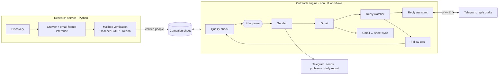

# Digging AI

**An AI outreach agent that digs up the right people, confirms their real email address, writes to each of them
personally, and keeps a human in control of everything that leaves the outbox.**

It finds organisations and the right person in each, finds and verifies their address with their own mail server,
drafts a personal email, checks every claim against the sender's real profile, sends on a safe schedule, reads the
replies, drafts answers you approve with one tap on Telegram, and keeps one Google Sheet as the single source of truth,
even when you also write emails by hand.

[](https://github.com/Beethoven04/digging-ai/actions/workflows/ci.yml)
 
 

**▶ Try it:** the full pipeline runs on your machine in one command (real n8n, demo campaign, mocked Gmail / Sheets /
LLM / Telegram, no accounts needed). Access is by request:
[**Request demo access**](https://github.com/Beethoven04/digging-ai/issues/new?template=demo-access.yml).

---

## Proven in production

Built for, and run on, a real campaign in October–November 2026: one person's master's-thesis search at AI companies
in southern Sweden, Greater Copenhagen and the Netherlands (two campaigns on one engine).

| Measure | Result |
|---|---|
| Bounce rate on cold emails (first campaign) | **under 0.5 %** |
| People found whose address was confirmed by their own mail server | **68 %** (the rest were held back, never guessed) |
| Emails whose claims were checked against the sender's real profile before sending | **all of them** |

What production taught, and how the code changed after each incident: [`docs/case-study.md`](docs/case-study.md).

## What it does

| | Automated | Human |
|---|---|---|
| **Research** | organisations from public sources, the right person, their published or inferred address, mailbox verification, catch-all detection | picks the target market |
| **Writing** | personal drafts, follow-ups in the same thread, answers to replies, intros to referred people | edits by typing an instruction ("shorter", "propose Thursday 14:00") |
| **Quality** | code rules + LLM rubric: every claim must match a Profile fact, one specific reason, one ask, natural voice, campaign guardrails | – |
| **Sending** | window, daily cap, gaps with jitter, one person per company per day, Gmail "Sent" check before every send | **one tick per email** |
| **Replies** | classify (interested, question, referral, not now, refusal, do-not-contact, auto-reply, bounce), stop follow-ups, add referred people | **✅ on Telegram** |
| **Bookkeeping** | sheet, append-only log, hand-written emails synced from Gmail, daily report | – |

## How it works



Full design, sequence and state diagrams, guards and failure handling: [`docs/architecture.md`](docs/architecture.md).
Why it is built this way: [`docs/adr/`](docs/adr/).

## Engineering highlights

- **Workflows as code.** All eight n8n workflows are generated by `n8n/build.py` from plain JavaScript and Markdown
  prompts, validated (graph, node references, `node --check`, no unfilled placeholder) and tested before they reach a
  server. Nothing is edited in the n8n UI.
- **One codebase, many campaigns.** A campaign is a JSON file: sheet, timezone, chats, credentials, schedules, owner
  identity and a *playbook* that tunes the prompts and adds guardrails. Job search, B2B sales or partnerships are
  playbooks, not forks ([`campaigns/`](campaigns/)).
- **Code for rules, LLM for judgement.** Anything checkable is code and cannot be hallucinated. The LLM must quote the
  text for every finding; quotes that are not in the text are flagged, not trusted. Groq takes over on any Gemini error.
- **Approval bound to content.** The Sender only sends a text whose hash matches the one the QC checked and the owner
  approved. An old Telegram card cannot send a newer draft.
- **Safe with a human in the loop.** The owner writes emails by hand too; a Gmail "Sent" check before every send and an
  hourly sync make sure nothing is sent twice.
- **Tested like software.** 147 end-to-end checks run every Code node against a demo campaign with mocked APIs; finder
  unit tests; ruff; a privacy scan; all in CI on every push. Changed workflows also run in a real n8n container against
  a mock of every API before deployment.

## Repository

| Folder | What |
|---|---|
| [`n8n/`](n8n/) | Outreach engine: `src/` (one file per workflow), `prompts/`, `build.py`, `tests/`, `tools/` |
| [`finder/`](finder/) | Research service: discovery sources, crawler, email-format inference, mailbox verification, sheet sync |
| [`campaigns/`](campaigns/) | Campaign files (only the example is public) and the field reference |
| [`infra/reacher/`](infra/reacher/) | Docker Compose for the self-hosted [Reacher](https://github.com/reacherhq/check-if-email-exists) SMTP verifier |
| [`docs/`](docs/) | Architecture, ADRs, sheet schema, setup, testing, case study |
| [`scripts/`](scripts/) | Privacy scan (CI and before every commit) |

## Developer quick start
```bash
make test-n8n        # build the example campaign's workflows + run the 147-check scenario (Node 18+)
make test-finder     # finder unit tests (pip install -r finder/requirements.txt -r finder/requirements-dev.txt)
make ci              # privacy scan + lint + all tests, as in CI
make build CAMPAIGN=campaigns/<name>.json   # importable workflows for a real campaign
```
Going live: [`docs/setup.md`](docs/setup.md) → [`docs/testing.md`](docs/testing.md) (dry run, test sends, live).

**Stack:** n8n (HTTP + Code nodes), JavaScript, Python, Google Sheets + Gmail APIs, Gemini Flash, Groq
(`gpt-oss-120b`), Telegram Bot API, Reacher, Reoon, Docker, GitHub Actions.

## Responsible use
Only public, professional sources (company websites, press, public commit metadata, official job-ad APIs). No leaked
databases, no LinkedIn scraping. Mailbox checks never send mail. Every outgoing email is approved by a person, and the
system is built for low-volume, one-to-one, relevant emails, not bulk mail.

## License and commercial use
**All rights reserved** ([`LICENSE`](LICENSE)). The code is public to read and evaluate. Using it, or running it for
clients, needs a license. For a license, a hosted setup, or the demo:
[open a demo-access request](https://github.com/Beethoven04/digging-ai/issues/new?template=demo-access.yml).

Built by **Louai Eddiaz**, AI engineer · [github.com/Beethoven04](https://github.com/Beethoven04)
