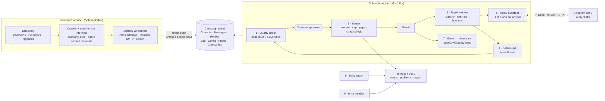
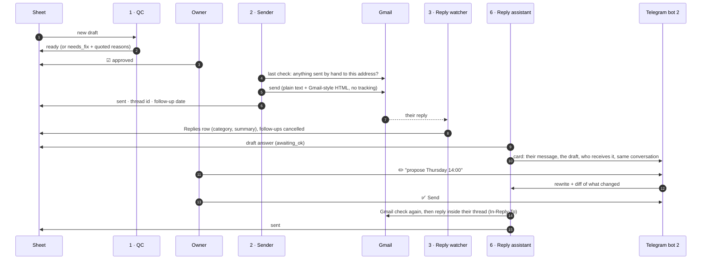
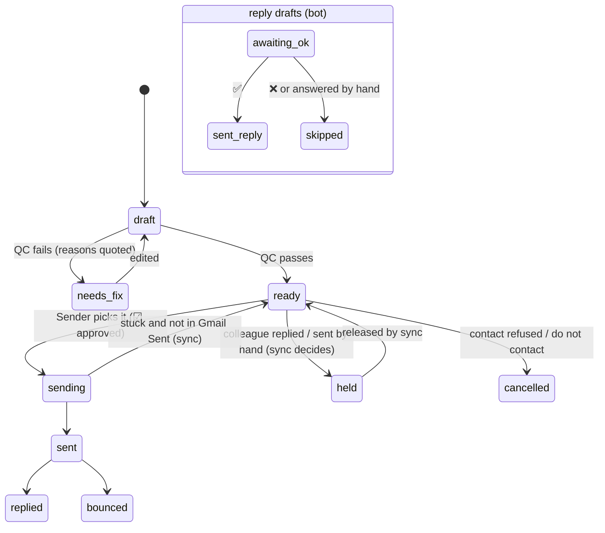

# Architecture

Digging AI has three parts: a **research service** (Python) that finds organisations, people and confirmed email
addresses; an **outreach engine** (eight n8n workflows) that checks, sends, watches and answers; and a **campaign
sheet** (Google Sheets) that both read and write. People stay in control through two Telegram bots and one tick-box.



## Components

| Component | Code | Responsibility |
|---|---|---|
| Discovery | `finder/discovery/` | Collect target organisations from public sources into a pool CSV |
| Finder | `finder/finder/` | Crawl each domain, find people and published addresses, infer the company's address format, verify mailboxes, push verified people to the sheet |
| Verifier | `infra/reacher/` | Self-hosted [Reacher](https://github.com/reacherhq/check-if-email-exists) SMTP check (needs outbound port 25) |
| Outreach engine | `n8n/src/*.js`, `n8n/prompts/*.md` | Eight workflows generated by `n8n/build.py`, one source file per workflow |
| Campaign | `campaigns/<name>.json` + one sheet | Everything that differs per deployment: sheet, chats, credentials, owner identity, schedules, playbook |

## The eight workflows

| # | Workflow | Trigger | Reads | Writes |
|---|---|---|---|---|
| 0 | Error handler | any workflow crash | – | Log, Telegram bot 1 |
| 1 | Quality check (LLM) | every 15 min | Config, Contacts, Messages, Profile, Companies | Messages (`ready` / `needs_fix`, score, quoted reasons, content hash) |
| 2 | Sender | every 5 min, inside the Config window | Config, Contacts, Messages, Log, Gmail Sent | Gmail, Messages, Log, bot 1 |
| 3 | Reply & bounce watcher | :02 :17 :32 :47 | Gmail threads + inbox search | Replies, Contacts (referrals), Messages, Log |
| 4 | Follow-up drafts | hourly on weekdays | Messages, Profile | Messages (`fu1`/`fu2` drafts → back to QC) |
| 5 | Daily report | 18:00 | everything | bot 1 (three messages) |
| 6 | Reply assistant (bot) | every 5 min + Telegram webhook | Replies, Messages, Profile, Gmail Sent | Messages (`awaiting_ok` drafts), Gmail (on ✅), bot 2 |
| 7 | Gmail ↔ sheet sync | hourly at :38 | Gmail Sent | Messages, Log, bot 1 + 2 |

## Life of one conversation



## Message lifecycle



## Guards

| Guard | How |
|---|---|
| Nothing leaves without approval | Sender needs ☑ `approved` and a text unchanged since QC (content hash). Reply drafts need ✅ on the newest card version; an old card cannot send. |
| Never twice | Append-only Log + content hash + "same type to the same address" check. Right before every send, one Gmail search `in:sent to:x after:<t>` catches emails the owner wrote by hand that the sheet does not know yet. If Gmail cannot be searched, nothing is sent that run. |
| The owner works by hand too | The sync reads Gmail Sent every hour: hand-written emails are logged, the queued email they replace is marked sent, open reply drafts they answered are closed, stuck rows are repaired. |
| Deliverability | Weekday window, daily cap, minimum gap + random jitter, one person per company per day, colleagues only if nobody there answered, auto-pause on any quota or credential error. |
| Gmail API quota | Every Gmail reader has its own minute; reads are batched; searches return ids only. |
| No invented claims | Code rules (length, dates, placeholders, banned phrases, signature leaks, wrong names, campaign guardrails) plus an LLM that must quote the text for every finding and check every claim against the Profile facts. A quote that is not in the text is flagged, not trusted. |
| Addresses | Published address > verified company format > nothing. Only mailbox-confirmed addresses are `valid`; catch-all domains need explicit approval; shared inboxes are never used. |
| Reply bot | Only the owner's chat id is obeyed; the card states the exact recipient (no CC) and whether it goes into the same conversation. |

## Workflows as code

```
n8n/src/common.js       helpers injected into every Code node (sheet tables, writer, dates, MIME, Gmail parsing, cards)
n8n/src/<workflow>.js   one file per workflow, one section per Code node (// ---- NODE: … / // @node key)
n8n/prompts/*.md        LLM system prompts with campaign placeholders ({{SENDER_NAME}}, {{GOAL}}, {{GUARDRAILS}} …)
n8n/build.py            wires nodes and connections, fills campaign values → n8n/workflows/*.json
```
`build.py` validates every workflow before writing it: unique node names, every connection and `$('Node')` reference
exists, every Code node passes `node --check`, no `__PLACEHOLDER__` or `{{PLACEHOLDER}}` is left. Nothing is edited
in the n8n UI.

## Several campaigns on one n8n

Each campaign builds its own eight workflows (prefixed with the campaign `name`) against its own sheet. They can
share credentials and Telegram chats:

- `telegram.message_prefix` marks every message of a campaign (for example `🇳🇱 NL · `).
- Telegram allows one webhook per bot, so one campaign owns the reply bot. Another campaign sets
  `reply_bot.webhook_path` (it receives forwarded updates) and `reply_bot.callback_prefix` (its buttons); the owning
  campaign sets `reply_bot.forward` with the other campaign's webhook URL, callback prefix, command and mark.
- Schedules of the second campaign are offset (`schedules`) so their Gmail reads never share a minute.

## Failure handling

| Failure | Behaviour |
|---|---|
| Primary LLM error or invalid JSON | Same request to the fallback LLM (Groq); both fail → row stays, retried next run, bot 1 told |
| Gmail quota / credential error | `SENDING_PAUSED = TRUE` + reason in Config, bot 1 alert with the fix |
| A send that may or may not have gone out (crash mid-run) | Row stays `sending`; the sync marks it `sent` if it is in Gmail Sent, otherwise back to `ready` after 20 min |
| Missing sheet column | Workflow stops with a Telegram error naming the column |
| Any unhandled crash | Error handler: Telegram alert with a fix hint + Log row |

Decisions behind this design: [`adr/`](adr/).
